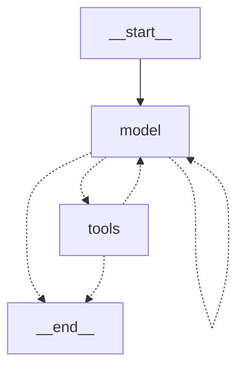

# The agent as a LangGraph StateGraph — local, 2026-10-14

Pre-registered in `langgraph-preregistration-2026-10-14.md` (committed before any live run of the graph).
Same model (`gemma-4-26b-a4b-qat`, Thinking off, temperature 0), backend, snippet length 800, retry on.

## What was built

Two nodes, `model` and `tools`, and conditional edges (`model -> tools | model | END`, `tools -> model | END`).
Tool validation and execution is the same function as in the reference loop (`execute_call`); the loop is
kept as the reference implementation and the graph is selectable with `RAG_AGENT_ENGINE=graph`
(`--engine graph` in the evaluation runner). Only LangGraph's orchestration is used: model calls go through
the package's own `ChatClient`, tool calls through `McpClient`, and tracing is left off. The default engine
is still the loop.

## Result

| Set | Cases | loop | graph |
|---|---|---|---|
| tool_calls_v1 (dev) | 26 | 26 | 26 |
| tool_calls_heldout_v1 | 27 | 26 | 26 |
| tool_calls_heldout_v2 | 22 | 21 | 21 |
| cross_document_v1, `single` | 12 | 9 | 9 |
| cross_document_v1, `decompose` | 12 | 12 | 12 |

**The pre-registered criterion (graph passes at least as many cases as the loop in every row) is met.**

In addition, 16 scripted scenarios in `tests/test_graph.py` require the two engines to return identical
results, make identical backend calls, and show the model the identical conversation (73 tests pass).

## A finding about the model server that matters more than the engine comparison

Per-case, the first live comparison was not identical: on the cross-document set `XD-01` and `XD-03`
passed in one engine and failed in the other (totals equal), and on held-out v1 14 answer texts and 3 turn
counts differed. To find out whether that was the engine, the *loop* was run a second time:

| Comparison (same questions, same code paths, same tool results) | answer texts that differ | pass flips |
|---|---|---|
| loop, first run vs loop, second run | 10 of 12 / 14 of 27 | 2 / 0 |
| loop, first run vs graph | 10 of 12 / 14 of 27 | 2 / 0 |
| **loop, second run vs graph** | **0 / 0** | **0 / 0** |

The graph reproduces the loop's second run exactly. What differs is the **first** run of each set in the
session against all later ones. The engine is not the cause; the model server's state (a cold start of
that prompt set against a warm one) changes the output of a temperature-0 request.

Consequences, as first written and as corrected after the re-check
(`recheck-first-run-effect-local-2026-10-14.md`):

- The first run of a set can differ in answer text and in *which* questions pass, so a per-question claim
  from a single run is weak. Totals hid a swap here: both engines scored 9/12 with two questions exchanged.
- **Correction:** I first wrote that this was a candidate explanation of the Java project's 43/45 against
  38/45. Re-running the agent sets 3 to 7 times each showed that this effect changed texts and one pair of
  questions but never a total, so it does not explain a 5-case gap. That gap is still unexplained.

## What this does not show

That LangGraph is better for this agent. The loop is shorter and does the same work; the graph is
justified here by being the form the ecosystem expects, and by making the control flow inspectable
(`get_graph()`, checkpointing and streaming are now possible). It adds 27 packages to the lock file.

One run per cell for the matrix, one model, one session, literal term matching.
